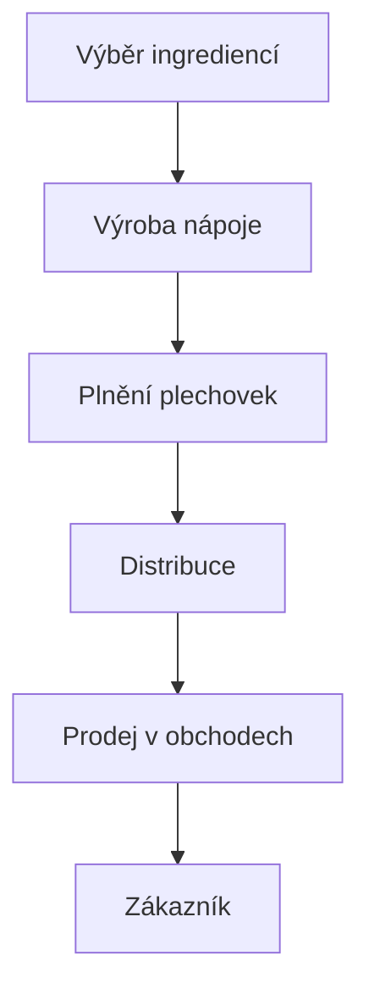

# Red Bull Energy Drink – Energie na každou výzvu

Red Bull je jeden z nejznámějších energetických nápojů na světě. Proslavil se svou chutí, modro-stříbrnou plechovkou a sloganem **„Red Bull ti dává křídla!“**

## 1. Základní informace

### Historie značky

- Značka Red Bull vznikla v roce **1987**.
- Jejím zakladatelem byl Dietrich Mateschitz.
- Inspirací byl energetický nápoj z Thajska.
- Dnes se prodává ve více než 170 zemích.

### Co obsahuje Red Bull?

- **Kofein** – stimulační látka.
- **Taurin** – látka přirozeně se vyskytující v lidském těle.
- **Cukr** – zdroj energie.
- Vitaminy skupiny B.

## 2. Druhy Red Bullu

Red Bull nabízí několik různých příchutí.

| Druh | Charakteristika |
|---|---|
| Original | Klasická chuť |
| Sugarfree | Bez cukru |
| Zero | Bez cukru |
| Watermelon | Melounová příchuť |
| Tropical | Tropické ovoce |
| Blue Edition | Borůvková příchuť |

## 3. Jak Red Bull vypadá?


*Originální plechovka Red Bull Energy Drink.*

## 4. Proč je Red Bull tak populární?

- **Marketing** – výrazné reklamy a známý slogan.
- **Sport** – podpora sportovců a sportovních týmů.
- **Motorsport** – Formule 1 a extrémní sporty.
- **Chuť** – charakteristická chuť nápoje.

### Známé projekty Red Bullu

1. Red Bull Racing – tým Formule 1.
2. Red Bull Air Race – letecké závody.
3. Red Bull Stratos – skok Felixe Baumgartnera ze stratosféry.

## 5. Red Bull ve Formuli 1

Red Bull patří mezi známé značky v motorsportu. Jeho tým **Oracle Red Bull Racing** se účastní závodů Formule 1.

Více informací:

- [Oficiální web Red Bullu](https://www.redbull.com/)
- [Red Bull Racing](https://www.redbullracing.com/)

## 6. Ukázka kódu v Pythonu

Jednoduchý program, který vypočítá množství kofeinu v nápojích.

```python
kofein_v_plechovce = 80
pocet_plechovek = 2

celkem = kofein_v_plechovce * pocet_plechovek

print("Celkové množství kofeinu:", celkem, "mg")
```

## 7. To-Do list

- [x] Zjistit historii Red Bullu.
- [x] Popsat jednotlivé druhy.
- [x] Přidat obrázek.
- [ ] Navštívit závod Formule 1.
- [ ] Vyzkoušet další příchutě.

## 8. Matematická rovnice

Jedna standardní plechovka Red Bullu o objemu 250 ml obsahuje přibližně 80 mg kofeinu.

```math
80 \times 2 = 160 \text{ mg}
```

Dvě plechovky tedy obsahují celkem 160 mg kofeinu.

## 9. Diagram výroby a prodeje



---

**Red Bull – dává křídla!**
